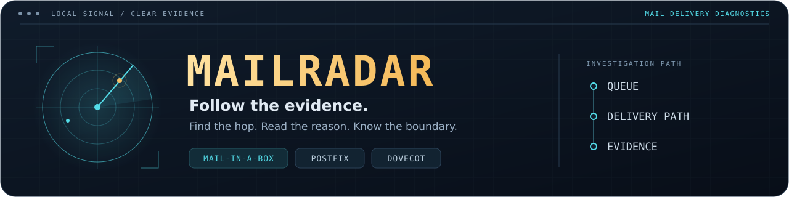
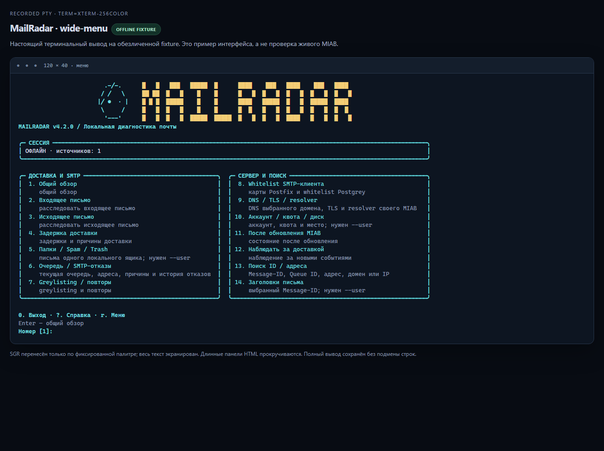
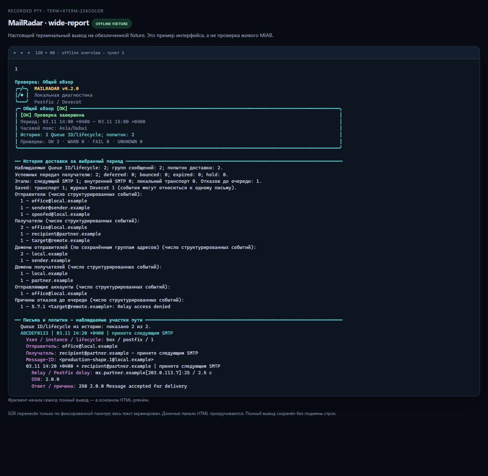
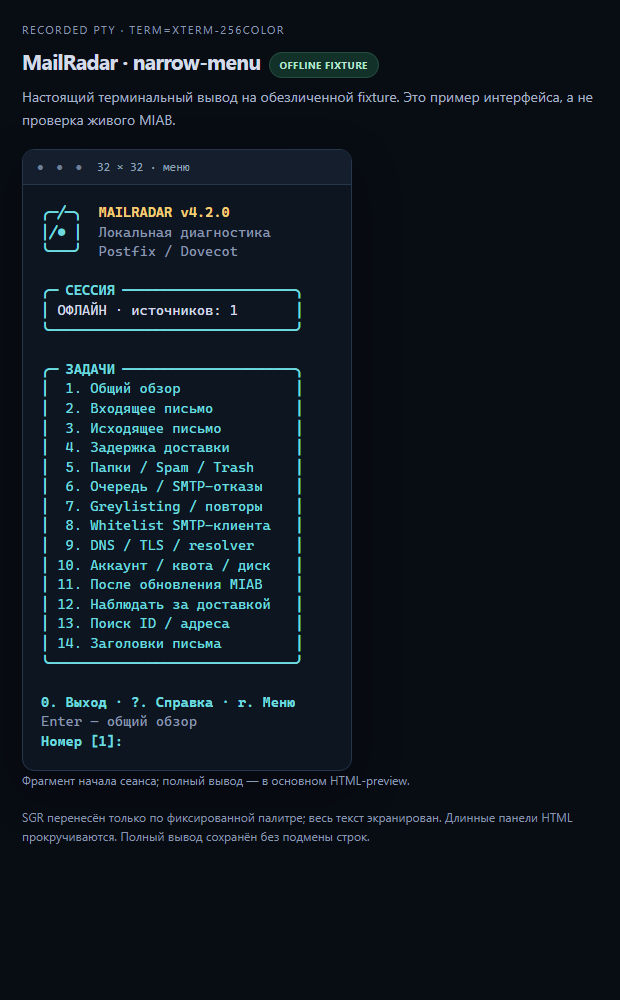

<div align="center">



**Know where your mail went. See what the evidence proves.**

Local delivery diagnostics for **Mail-in-a-Box · Postfix · Dovecot**.

[](https://github.com/Anton-Babaskin/mail-radar/actions/workflows/ci.yml)
[](CHANGELOG.md)
[](#requirements)
[](docs/validation.md)
[](LICENSE)

**English** · [Русский](README.ru.md) · [Українська](README.uk.md)

[Quick start](#quick-start) · [Workflows](#choose-a-workflow) · [Screenshots](#terminal-experience) · [Next version](#next-version--proposed-43)

</div>

---

MailRadar brings the current queue, delivery history, SMTP refusals and mailbox
evidence into one investigation. Reports show addresses, domains, Queue IDs,
timestamps and reasons, with clear boundaries between confirmed facts and missing
data. It runs locally, without a cloud account, AI service or runtime pip packages.

| Follow a message | Understand the server | Keep the evidence |
|:---|:---|:---|
| Correlate Postfix hops, recipients, delays and Dovecot Saved events. | Inspect queues, DNS/TLS, greylisting, whitelist, quota and post-update state. | Read the terminal report, open details or export JSON/NDJSON and a private report. |

> **Language:** these READMEs are available in English, Russian and Ukrainian.
> The **4.2.0 menu, prompts and human reports are in Russian**. CLI flags and JSON
> keys stay language independent; translated terminal UI is on the roadmap.

## Terminal experience



*Actual 120×40 PTY session using synthetic offline fixtures. This screenshot
demonstrates the interface; it is not evidence of a live MIAB validation.*

The gold wordmark and cyan radar adapt to the window. Wide terminals show task
cards; ordinary SSH windows get a compact header; narrow windows use one column.
Reports keep **the current queue separate from historical Queue IDs and attempts**.
Long addresses and reasons wrap without being discarded to fit a card.

| Key / option | Action |
|---|---|
| `1`–`14` | Select an investigation |
| `Enter` | Open the overview; return to the menu after a report |
| `?` / `r` | Show help / redraw after resizing |
| `0` / `q` / `Ctrl+C` | Leave the menu session |
| `--details` | Show more checks and evidence |
| `--no-color` | Disable color; nonempty `NO_COLOR` and `TERM=dumb` also disable it |

<details>
<summary><strong>Report layout and narrow-terminal view</strong></summary>



*Report excerpt from the same offline fixture; full output remains scrollable.*



*A real 32-column PTY recording. Very narrow terminals may require vertical scrolling.*

</details>

## Quick start

### Requirements

- **Target:** Mail-in-a-Box on Ubuntu 22.04. Basic diagnostics also target compatible
  Postfix/Dovecot hosts on Debian/Ubuntu; Mailcow/iRedMail need separate adapters.
- **Runtime:** Bash and Python **3.9+**, using the standard library.
- Run with `sudo` to access protected logs and local service metadata. Without it,
  unavailable checks remain `UNKNOWN`.

```bash
git clone https://github.com/Anton-Babaskin/mail-radar.git
cd mail-radar
bash ./mail-radar --version
sudo bash ./mail-radar --menu
```

Running without arguments opens the menu in an interactive terminal. Use
`--doctor` for a direct overview. Redirected output and JSON/NDJSON have no menu,
artwork or ANSI colors. The compatible command name `miab-radar` is retained.

### Install a global command

Review the checkout, then install MailRadar's own files:

```bash
sudo bash ./install.sh
mail-radar --version
sudo mail-radar --menu
```

The installer updates `/usr/local/bin/{mail-radar,miab-radar}` and
`/usr/local/lib/mail-radar/mailradar/`. It checks the runtime manifest, Python syntax
and internal imports before replacing files. It does not install OS packages or
restart services. See the [installation details](docs/usage.md#installation) for
staging, prefixes and limitations.

### Update an existing copy

Save local changes first. Update the checkout; repeating `git clone` does not update it:

```bash
cd /path/to/mail-radar
git switch main
git pull --ff-only origin main
bash ./mail-radar --version
sudo bash ./mail-radar --menu
```

**Using the global `mail-radar` command?** Run `sudo bash ./install.sh` again after
pulling, then check `mail-radar --version`. Updating the checkout alone does not
update the installed copy.

## Choose a workflow

| Menu | CLI | What you see |
|:---:|---|---|
| 1 | `--doctor` | Overview of available services, configuration, queue and log evidence |
| 2 | `--incoming` | Incoming message path, recipients and delivery evidence |
| 3 | `--outgoing` | Outgoing handoffs, SMTP responses and failure causes |
| 4 | `--delay` | Delays, deferred attempts and retry evidence |
| 5 | `--mailboxes --user ADDRESS` | One local account's folder/metadata evidence; `--deep` adds physical inspection |
| 6 | `--queue` | Current Queue ID, sender, recipients, age, size and reasons; history separately |
| 7 | `--greylist` | Postgrey triplets, refusals, passes and observed retries |
| 8 | `--whitelist` | SMTP-client maps, matches, ordering and policy-service implications |
| 9 | `--dns --domain DOMAIN` | Selected domain's DNS; this server's TLS, resolver and relay |
| 10 | `--account --user ADDRESS` | Account, quota resources and filesystem capacity |
| 11 | `--post-update` | Services, Postfix, whitelist, resolver and backup-tooling signals |
| 12 | `--watch` | Bounded observation of new log events; NDJSON with `--json` |
| 13 | `--trace VALUE` | Literal Message-ID, Queue ID, address, domain or IP search |
| 14 | `--headers MESSAGE_ID --user ADDRESS` | Selected headers, folder, UID and flags for one local mailbox |

`--diagnose` combines a targeted delivery investigation; `--flow` shows shared-window
statistics. Use `--hours N` or explicit `--since` / `--until` timestamps with offsets.

### Everyday investigations

```bash
# A missing message: start with the addresses, no Message-ID required.
sudo bash ./mail-radar --incoming --from sender@example.org --to office@example.com --hours 24

# Current queue entries and historical refusals, with more evidence.
sudo bash ./mail-radar --queue --details

# Locate a known message in one local mailbox without reading its body.
sudo bash ./mail-radar --headers '<message.1@example.org>' --user office@example.com

# Reproduce an investigation from the included log without host commands or network.
bash ./mail-radar --trace sender.example --offline --log ./examples/mail.log --since '2026-11-02T09:00:00Z' --until '2026-11-02T10:00:00Z'

# Create a new private JSON report; existing paths are refused.
sudo bash ./mail-radar --diagnose --to office@example.com --hours 24 --json --redact --report /root/incident-new.json
```

### What does entering a domain do?

`--domain` filters matching log history and, in DNS workflows, identifies the DNS
target. **It does not log into that domain's server or fetch its private mail logs.**
Services, queue, resolver, relay and local TLS configuration belong to the host
where MailRadar is running. Reports label these scopes separately.

Local analysis is the default. `--network` explicitly permits bounded DNS/TLS/local
management-endpoint probes; the menu asks before enabling them. No test message,
SMTP AUTH or real relay delivery is performed. DNSBL errors are not treated as
proof that an address is clean or listed.

## Read the result correctly

| Status | Meaning |
|---|---|
| 🟢 `OK` | Available evidence confirms this check |
| 🟡 `WARN` | A confirmed condition needs review |
| 🔴 `FAIL` | A confirmed failure needs attention |
| 🔵 `UNKNOWN` | Evidence, permissions, support or coverage is insufficient |
| ⚪ `N/A` | The check does not apply |

An empty match set does not prove delivery. A remote SMTP `250` confirms acceptance
by the next hop; Dovecot `Saved` confirms storage at that event, not the current folder.
Source limits, unparsed records and missing context remain visible.

Exit codes: **0** clean observed scope · **1** warning/unknown/incomplete · **2** failure
or invalid arguments · **3** runtime/report-file error · **130** interrupted.
JSON schema `1.0`, finding IDs and exit semantics are independent of terminal styling.

### Privacy and operating boundary

Diagnosis does not change mail configuration, queues, messages, holds, packages,
routes or service state. Dovecot metadata reads may refresh service indexes.
Bodies, attachments and credential files are not intentionally collected.
`--report NEW_PATH` creates a private `0600` file and refuses existing files/symlinks.
`--redact` aliases identifiers consistently within an export; review free text,
paths and IDs before sharing. **It is not guaranteed anonymization.** Reports are
not automatically sent to email, Telegram or another service.

## Next version — proposed 4.3

These are **planned improvements, not available 4.2.0 features or a release-date promise**.
The first priority is stronger evidence from real MIAB systems.

| Priority | Work | Ready when |
|---|---|---|
| P1 | Real MIAB acceptance and anonymized fixtures | All 14 workflows are compared with local Postfix/Dovecot facts; environment and limits are recorded. |
| P1 | More real log formats | Confirmed `NOQUEUE filter/hold/discard`, header warnings and separate SMTP replies have fixtures and regressions; unsupported grammar still marks coverage incomplete. |
| P1 | Current queues across Postfix instances | Each queue identifies its instance; unavailable instances are reported; equal Queue IDs from different instances remain separate. |
| P2 | English / Russian / Ukrainian terminal UI | `--lang en\|ru\|uk` covers menu, prompts, errors and reports without changing JSON keys, finding IDs or facts. |
| P2 | Easier long investigations | Queue-list navigation, filters and period selection work at 32/80/120 columns; watch gaps have clear recovery guidance. |
| P2 | Deeper DNSBL configuration coverage | Direct restrictions, restriction classes and access-map actions are distinguished; unresolved dynamic cases remain `UNKNOWN`, credential maps stay unread. |

Current limits also include non-atomic queue snapshots, possible watch rotation
gaps and no proof of a remote final INBOX. The current release has **not yet been
validated on a live MIAB**; the completed checks use fixtures and isolated Linux environments.

## Documentation and validation

| Start here | Contents |
|---|---|
| [Extended usage](docs/usage.md) | Detailed installation, filters, timestamps, log sources, network and JSON contracts (EN/RU) |
| [Workflow guide](docs/task-reports.ru.md) | All 14 scenarios and report examples (RU) |
| [Terminal design](docs/terminal-ui.ru.md) | Layout, colors, accessibility and output boundaries (RU) |
| [MVP audit](docs/mvp.ru.md) | Confirmed fixes, scope and remaining limitations (RU) |
| [Validation record](docs/validation.md) | Executed checks, environments and qualifications |
| [Architecture](docs/adr/0001-diagnostics-architecture.md) · [Integrations](docs/integrations.md) | Module boundaries and responsibilities of related projects |
| [Changelog](CHANGELOG.md) | Version history |

The 4.2.0 validation recorded **301 passing tests on each of Python 3.9 and 3.10**,
plus Ruff, ShellCheck, Bash syntax and real PTY checks. CI uses Ubuntu 22.04,
synthetic logs and fake host commands; real `dig` integration tests query only an
ephemeral loopback DNS fixture. These results do not establish live-server acceptance.

<details>
<summary><strong>Development checks</strong></summary>

```bash
python3 -m pip install -r requirements-dev.txt
ruff check mailradar tests
python3 -m unittest discover -s tests -v
for script in mail-radar miab-radar install.sh; do bash -n "$script"; done
shellcheck mail-radar miab-radar install.sh
```

Install `dnsutils` to run the real `dig` fixture cases locally. Runtime diagnostics
do not need Ruff or pip. CI results are linked by the live badge above.

</details>

---

<div align="center">

**MailRadar** · Created by [Anton Babaskin](https://github.com/Anton-Babaskin) · [MIT](LICENSE)

[Report a bug](https://github.com/Anton-Babaskin/mail-radar/issues) · [View changes](CHANGELOG.md) · [Back to top](#readme)

</div>
