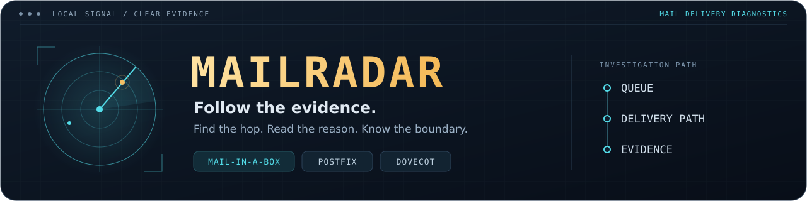
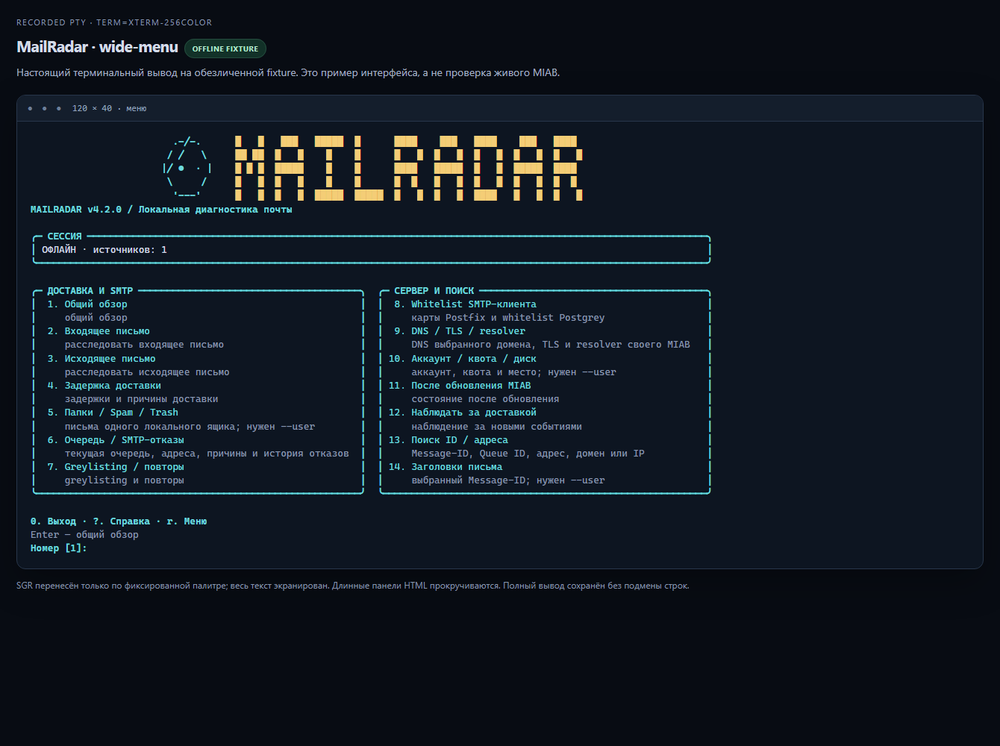
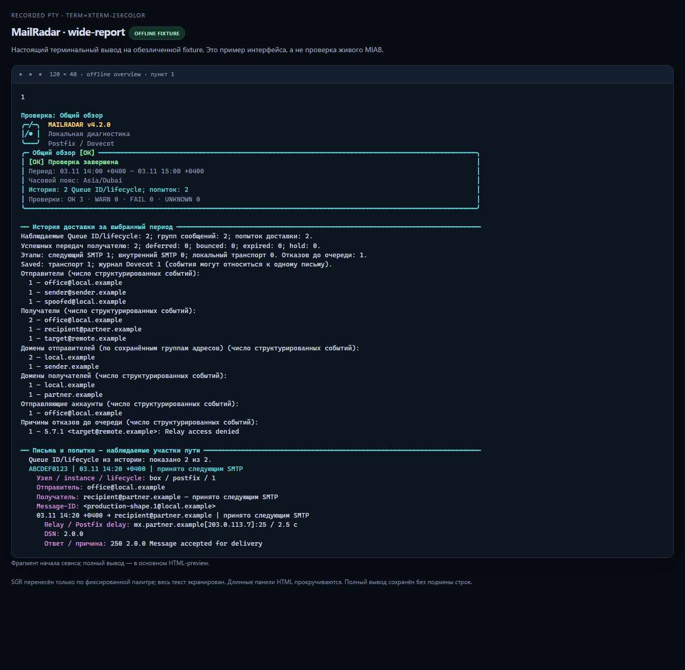
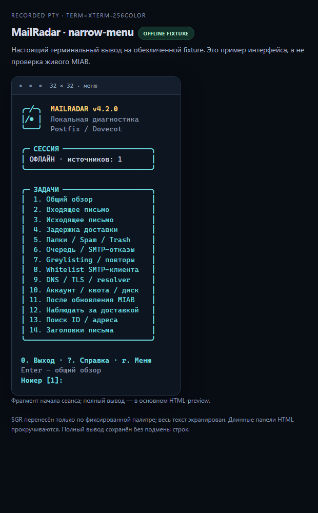

<div align="center">



**Узнайте, куда ушло письмо. Увидьте, что подтверждают данные.**

Локальная диагностика доставки для **Mail-in-a-Box · Postfix · Dovecot**.

[](https://github.com/Anton-Babaskin/mail-radar/actions/workflows/ci.yml)
[](CHANGELOG.md)
[](#требования)
[](docs/validation.md)
[](LICENSE)

[English](README.md) · **Русский** · [Українська](README.uk.md)

[Быстрый старт](#быстрый-старт) · [Сценарии](#выберите-сценарий) · [Скриншоты](#терминальный-интерфейс) · [Следующая версия](#следующая-версия--план-43)

</div>

---

MailRadar объединяет текущую очередь, историю доставки, SMTP-отказы и данные
почтового ящика в одном расследовании. В отчёте видны адреса, домены, Queue ID,
время событий и причины, а подтверждённые факты отделены от недостающих данных.
Всё работает локально: без облачного аккаунта, ИИ-сервиса и установки пакетов через pip.

| Проследите путь письма | Разберитесь с сервером | Сохраните доказательства |
|:---|:---|:---|
| Свяжите этапы Postfix, получателей, задержки и события Dovecot Saved. | Проверьте очередь, DNS/TLS, greylisting, whitelist, квоту и состояние после обновления. | Прочитайте отчёт в терминале, раскройте подробности или экспортируйте JSON/NDJSON и приватный файл. |

> **Языки:** README доступны на английском, русском и украинском.
> В версии **4.2.0 меню, вопросы и текстовые отчёты — на русском**. Флаги CLI и
> ключи JSON не зависят от языка; перевод терминального интерфейса запланирован.

## Терминальный интерфейс



*Настоящая PTY-сессия размером 120×40 на синтетических offline-данных. Скриншот
показывает интерфейс; он не подтверждает проверку на работающем MIAB.*

Золотой логотип и бирюзовый радар подстраиваются под окно. В широком терминале
задачи расположены в карточках; в обычном SSH-окне шапка компактная; в узком — одна
колонка. Отчёты показывают **текущую очередь отдельно от Queue ID и попыток в истории**.
Длинные адреса и причины переносятся без удаления текста ради рамки.

| Клавиша / параметр | Действие |
|---|---|
| `1`–`14` | Выбрать сценарий расследования |
| `Enter` | Открыть общий обзор; после отчёта вернуться в меню |
| `?` / `r` | Показать справку / перерисовать меню после изменения размера |
| `0` / `q` / `Ctrl+C` | Завершить сессию меню |
| `--details` | Показать больше проверок и доказательств |
| `--no-color` | Отключить цвет; непустой `NO_COLOR` и `TERM=dumb` тоже его отключают |

<details>
<summary><strong>Отчёт и вид в узком терминале</strong></summary>



*Фрагмент отчёта на тех же offline-данных; полный вывод можно прокручивать.*



*Настоящая PTY-запись на 32 колонки. В очень узком терминале может понадобиться вертикальная прокрутка.*

</details>

## Быстрый старт

### Требования

- **Целевая среда:** Mail-in-a-Box на Ubuntu 22.04. Базовая диагностика также
  рассчитана на совместимые Postfix/Dovecot в Debian/Ubuntu; для Mailcow/iRedMail нужны отдельные адаптеры.
- **Для запуска:** Bash и Python **3.9+**, только стандартная библиотека.
- Запускайте с `sudo` для доступа к защищённым журналам и метаданным локальных
  служб. Без него недоступные проверки остаются `UNKNOWN`.

```bash
git clone https://github.com/Anton-Babaskin/mail-radar.git
cd mail-radar
bash ./mail-radar --version
sudo bash ./mail-radar --menu
```

Запуск без аргументов открывает меню в интерактивном терминале. Для общего обзора
сразу используйте `--doctor`. Перенаправленный вывод и JSON/NDJSON не содержат
меню, рисунков и ANSI-цветов. Совместимое имя команды `miab-radar` сохранено.

### Установка глобальной команды

Проверьте содержимое репозитория, затем установите собственные файлы MailRadar:

```bash
sudo bash ./install.sh
mail-radar --version
sudo mail-radar --menu
```

Установщик обновляет `/usr/local/bin/{mail-radar,miab-radar}` и
`/usr/local/lib/mail-radar/mailradar/`. До замены файлов он проверяет manifest
runtime, синтаксис Python и внутренние импорты. Пакеты ОС не устанавливаются,
службы не перезапускаются. Префиксы, установка в промежуточный каталог и ограничения
описаны в [подробной инструкции](docs/usage.md#installation).

### Обновление существующей копии

Сначала сохраните локальные изменения. Обновите рабочую копию; повторный `git clone` её не обновляет:

```bash
cd /path/to/mail-radar
git switch main
git pull --ff-only origin main
bash ./mail-radar --version
sudo bash ./mail-radar --menu
```

**Пользуетесь глобальной командой `mail-radar`?** После обновления выполните
`sudo bash ./install.sh` ещё раз и проверьте `mail-radar --version`. Обновление
Git-каталога само по себе не обновляет установленную копию.

## Выберите сценарий

| Меню | CLI | Что видно в отчёте |
|:---:|---|---|
| 1 | `--doctor` | Обзор доступных служб, конфигурации, очереди и событий журнала |
| 2 | `--incoming` | Путь входящего письма, получатели и подтверждения доставки |
| 3 | `--outgoing` | Передача исходящего письма, SMTP-ответы и причины сбоев |
| 4 | `--delay` | Задержки, deferred-попытки и подтверждённые повторы |
| 5 | `--mailboxes --user ADDRESS` | Папки и метаданные одного локального аккаунта; `--deep` добавляет проверку файлов |
| 6 | `--queue` | Текущие Queue ID, отправитель, получатели, возраст, размер и причины; история отдельно |
| 7 | `--greylist` | Triplet Postgrey, отказы, пропуски и наблюдаемые повторы |
| 8 | `--whitelist` | Карты SMTP-клиентов, совпадения, порядок и влияние на policy services |
| 9 | `--dns --domain DOMAIN` | DNS выбранного домена; TLS, resolver и relay этого сервера |
| 10 | `--account --user ADDRESS` | Аккаунт, ресурсы квот и место в файловой системе |
| 11 | `--post-update` | Службы, Postfix, whitelist, resolver и признаки состояния backup-инструментов |
| 12 | `--watch` | Ограниченное наблюдение за новыми событиями; NDJSON с `--json` |
| 13 | `--trace VALUE` | Буквальный поиск Message-ID, Queue ID, адреса, домена или IP |
| 14 | `--headers MESSAGE_ID --user ADDRESS` | Выбранные заголовки, папка, UID и флаги одного локального ящика |

`--diagnose` объединяет целевую диагностику доставки; `--flow` показывает
статистику в общем временном окне. Задайте `--hours N` или явные `--since` / `--until`
с указанием смещения часового пояса.

### Повседневные расследования

```bash
# Письмо не пришло: начните с адресов, Message-ID заранее знать не нужно.
sudo bash ./mail-radar --incoming --from sender@example.org --to office@example.com --hours 24

# Текущая очередь и исторические отказы с подробными доказательствами.
sudo bash ./mail-radar --queue --details

# Найти известное письмо в одном локальном ящике без чтения тела.
sudo bash ./mail-radar --headers '<message.1@example.org>' --user office@example.com

# Воспроизвести расследование по включённому журналу без системных команд и сети.
bash ./mail-radar --trace sender.example --offline --log ./examples/mail.log --since '2026-11-02T09:00:00Z' --until '2026-11-02T10:00:00Z'

# Создать новый приватный JSON-отчёт; существующие пути не перезаписываются.
sudo bash ./mail-radar --diagnose --to office@example.com --hours 24 --json --redact --report /root/incident-new.json
```

### Что происходит при вводе домена?

`--domain` фильтрует подходящие события журнала, а в DNS-сценариях задаёт цель
DNS-проверки. **Он не подключается к серверу этого домена и не получает его приватные
почтовые журналы.** Службы, очередь, resolver, relay и локальная конфигурация TLS
относятся к узлу, на котором запущен MailRadar. В отчёте эти области подписаны отдельно.

По умолчанию анализ локальный. `--network` явно разрешает ограниченные DNS/TLS-пробы
и проверки локальных management endpoints; меню спрашивает перед их включением.
Тестовые письма, SMTP AUTH и реальная доставка через relay не выполняются.
Ошибки DNSBL не считаются доказательством чистой репутации или попадания в список.

## Как читать результат

| Статус | Значение |
|---|---|
| 🟢 `OK` | Доступные данные подтверждают эту проверку |
| 🟡 `WARN` | Подтверждённая ситуация требует проверки |
| 🔴 `FAIL` | Подтверждённый сбой требует внимания |
| 🔵 `UNKNOWN` | Недостаточно данных, прав, поддержки формата или покрытия |
| ⚪ `N/A` | Проверка неприменима |

Отсутствие совпадений не доказывает доставку. Удалённый SMTP `250` подтверждает
приём следующим узлом; Dovecot `Saved` — сохранение в момент события, а не текущую
папку. Лимиты источников, неразобранные записи и недостающий контекст остаются видимыми.

Коды выхода: **0** — в наблюдаемой области проблем нет · **1** — предупреждение,
неизвестность или неполнота · **2** — сбой или неверные аргументы · **3** — ошибка
выполнения/файла отчёта · **130** — прервано. Схема JSON `1.0`, finding ID и смысл
кодов выхода не зависят от оформления терминала.

### Приватность и границы работы

Диагностика не меняет почтовую конфигурацию, очереди, письма, holds, пакеты,
маршруты и состояние служб. Чтение метаданных Dovecot может обновлять индексы службы.
Тела писем, вложения и файлы учётных данных намеренно не собираются.
`--report NEW_PATH` создаёт приватный файл `0600` и отклоняет существующие файлы/симлинки.
`--redact` согласованно заменяет идентификаторы псевдонимами в пределах экспорта;
перед публикацией проверьте свободный текст, пути и ID. **Полная анонимизация
не гарантируется.** Отчёты не отправляются автоматически в почту, Telegram или другой сервис.

## Следующая версия — план 4.3

Это **планируемые улучшения, а не доступные функции 4.2.0 или обещание даты релиза**.
Первый приоритет — подтверждение работы на настоящих MIAB-системах.

| Приоритет | Работа | Критерий готовности |
|---|---|---|
| P1 | Проверка на настоящем MIAB и обезличенные fixtures | Все 14 сценариев сверены с локальными данными Postfix/Dovecot; среда и ограничения зафиксированы. |
| P1 | Больше реальных форматов журналов | Подтверждённые `NOQUEUE filter/hold/discard`, header warnings и отдельные SMTP-ответы покрыты fixtures и регрессиями; неподдерживаемый формат по-прежнему делает покрытие неполным. |
| P1 | Текущие очереди нескольких Postfix instances | У каждой очереди указан instance; недоступные instances отражены; одинаковые Queue ID разных instances остаются раздельными. |
| P2 | Терминальный интерфейс на английском, русском и украинском | `--lang en\|ru\|uk` охватывает меню, вопросы, ошибки и отчёты без изменения ключей JSON, finding ID и фактов. |
| P2 | Удобство больших расследований | Навигация по очереди, фильтры и выбор периода работают на 32/80/120 колонках; для пробелов watch есть понятные шаги продолжения анализа. |
| P2 | Более полное покрытие конфигурации DNSBL | Прямые restrictions, restriction classes и действия access maps различаются; неразрешённые динамические случаи остаются `UNKNOWN`, credential maps не читаются. |

Среди текущих ограничений — неатомарный снимок очереди, возможные пропуски watch
при ротации и отсутствие доказательства конечного удалённого INBOX. Текущая версия
**ещё не проверена на работающем MIAB**; выполненные проверки используют fixtures
и изолированные Linux-среды.

## Документация и проверки

| С чего начать | Содержание |
|---|---|
| [Подробное использование](docs/usage.md) | Установка, фильтры, время, источники журналов, сеть и JSON-контракты (EN/RU) |
| [Руководство по сценариям](docs/task-reports.ru.md) | Все 14 сценариев и примеры отчётов (RU) |
| [Дизайн терминала](docs/terminal-ui.ru.md) | Разметка, цвета, доступность и границы вывода (RU) |
| [Аудит MVP](docs/mvp.ru.md) | Подтверждённые исправления, область проверки и оставшиеся ограничения (RU) |
| [Протокол проверок](docs/validation.md) | Выполненные проверки, среды и оговорки |
| [Архитектура](docs/adr/0001-diagnostics-architecture.md) · [Интеграции](docs/integrations.md) | Границы модулей и ответственность соседних проектов |
| [История изменений](CHANGELOG.md) | Изменения по версиям |

Для 4.2.0 зафиксировано **301 пройденный тест на каждой из версий Python 3.9 и 3.10**,
а также Ruff, ShellCheck, синтаксис Bash и настоящие PTY-проверки. CI использует
Ubuntu 22.04, синтетические журналы и подменённые системные команды; интеграционные
тесты настоящего `dig` обращаются только к временному DNS-серверу на loopback.
Эти результаты не подтверждают проверку на работающем сервере.

<details>
<summary><strong>Проверки при разработке</strong></summary>

```bash
python3 -m pip install -r requirements-dev.txt
ruff check mailradar tests
python3 -m unittest discover -s tests -v
for script in mail-radar miab-radar install.sh; do bash -n "$script"; done
shellcheck mail-radar miab-radar install.sh
```

Установите `dnsutils`, чтобы локально запустить fixtures с настоящим `dig`.
Для самой диагностики Ruff и pip не нужны. Ссылка на результаты CI — в бейдже выше.

</details>

---

<div align="center">

**MailRadar** · Автор: [Anton Babaskin](https://github.com/Anton-Babaskin) · [MIT](LICENSE)

[Сообщить об ошибке](https://github.com/Anton-Babaskin/mail-radar/issues) · [Изменения](CHANGELOG.md) · [Наверх](#readme)

</div>
