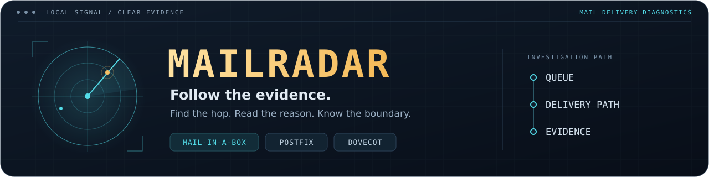
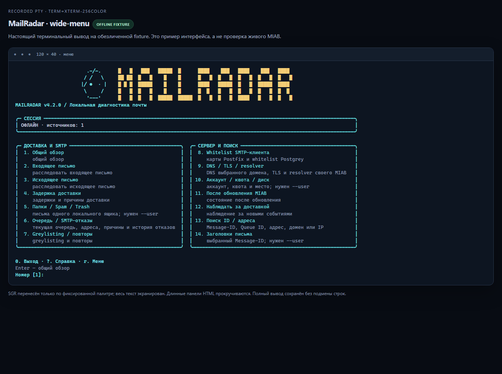
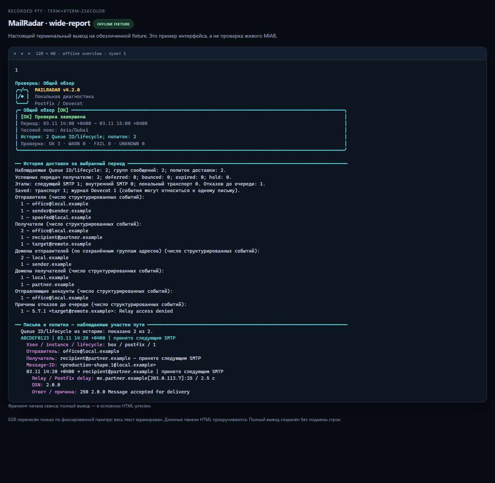
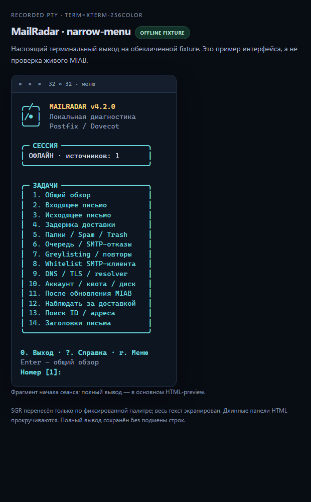

<div align="center">



**Знайте, куди потрапила ваша пошта. Бачте, що підтверджують дані.**

Локальна діагностика доставки для **Mail-in-a-Box · Postfix · Dovecot**.

[](https://github.com/Anton-Babaskin/mail-radar/actions/workflows/ci.yml)
[](CHANGELOG.md)
[](#вимоги)
[](docs/validation.md)
[](LICENSE)

[English](README.md) · [Русский](README.ru.md) · **Українська**

[Швидкий старт](#швидкий-старт) · [Сценарії](#виберіть-сценарій) · [Знімки екрана](#термінальний-інтерфейс) · [Наступна версія](#наступна-версія--попередній-план-43)

</div>

---

MailRadar об'єднує поточну чергу, історію доставки, SMTP-відмови та дані поштової
скриньки в одне дослідження. Звіти показують адреси, домени, Queue ID, час і
причини, чітко відокремлюючи підтверджені факти від відсутніх даних. Програма
працює локально, без хмарного облікового запису, ШІ-сервісу чи пакетів pip під час запуску.

| Простежте шлях листа | Зрозумійте стан сервера | Збережіть докази |
|:---|:---|:---|
| Зіставляйте переходи Postfix, одержувачів, затримки та події Dovecot Saved. | Перевіряйте черги, DNS/TLS, greylisting, whitelist, квоти та стан після оновлення. | Переглядайте звіт у терміналі, відкривайте подробиці або експортуйте JSON/NDJSON і приватний файл звіту. |

> **Мова:** README доступні англійською, російською та українською.
> У версії **4.2.0 меню, запити введення та текстові звіти — російською**.
> Прапорці CLI та ключі JSON не залежать від мови; переклад термінального
> інтерфейсу заплановано на майбутнє.

## Термінальний інтерфейс



*Справжня PTY-сесія 120×40 із синтетичними даними для автономних тестів.
Знімок демонструє інтерфейс, а не підтверджує перевірку на робочому MIAB.*

Золотий логотип і бірюзовий радар підлаштовуються під розмір вікна. У широкому
терміналі завдання розміщено в картках, у звичайному SSH-вікні шапка компактна,
у вузькому — одна колонка. Звіти показують **поточну чергу окремо від Queue ID
та спроб доставки в історії**. Довгі адреси й причини переносяться без втрати тексту
заради розміру картки.

| Клавіша / параметр | Дія |
|---|---|
| `1`–`14` | Вибрати сценарій дослідження |
| `Enter` | Відкрити огляд; після звіту повернутися до меню |
| `?` / `r` | Відкрити довідку / перемалювати меню після зміни розміру |
| `0` / `q` / `Ctrl+C` | Завершити сеанс меню |
| `--details` | Показати більше перевірок і доказів |
| `--no-color` | Вимкнути колір; непорожній `NO_COLOR` і `TERM=dumb` також його вимикають |

<details>
<summary><strong>Вигляд звіту та вузького термінала</strong></summary>



*Фрагмент звіту з тих самих автономних тестових даних; повний вивід можна прокручувати.*



*Справжній запис PTY завширшки 32 колонки. У дуже вузькому терміналі може знадобитися вертикальне прокручування.*

</details>

## Швидкий старт

### Вимоги

- **Цільова платформа:** Mail-in-a-Box на Ubuntu 22.04. Базова діагностика також
  розрахована на сумісні вузли Postfix/Dovecot у Debian/Ubuntu; для Mailcow/iRedMail
  потрібні окремі адаптери.
- **Середовище виконання:** Bash і Python **3.9+** зі стандартною бібліотекою.
- Запускайте із `sudo` для доступу до захищених журналів і локальних метаданих
  служб. Без нього недоступні перевірки матимуть статус `UNKNOWN`.

```bash
git clone https://github.com/Anton-Babaskin/mail-radar.git
cd mail-radar
bash ./mail-radar --version
sudo bash ./mail-radar --menu
```

Запуск без аргументів відкриває меню в інтерактивному терміналі. Для огляду без
меню використовуйте `--doctor`. Перенаправлений вивід і JSON/NDJSON не містять
меню, графіки чи ANSI-кольорів. Сумісну назву команди `miab-radar` збережено.

### Установлення глобальної команди

Перегляньте отримані вихідні файли, а потім установіть власні файли MailRadar:

```bash
sudo bash ./install.sh
mail-radar --version
sudo mail-radar --menu
```

Інсталятор оновлює `/usr/local/bin/{mail-radar,miab-radar}` і
`/usr/local/lib/mail-radar/mailradar/`. Перед заміною файлів він перевіряє маніфест
середовища виконання, синтаксис Python і внутрішні імпорти. Він не встановлює
системних пакетів і не перезапускає служб. Проміжне встановлення, префікси та
обмеження описані в [подробицях установлення](docs/usage.md#installation).

### Оновлення наявної копії

Спочатку збережіть локальні зміни. Оновіть робочу копію: повторний `git clone` її не оновлює.

```bash
cd /path/to/mail-radar
git switch main
git pull --ff-only origin main
bash ./mail-radar --version
sudo bash ./mail-radar --menu
```

**Користуєтеся глобальною командою `mail-radar`?** Після отримання змін ще раз
виконайте `sudo bash ./install.sh` і перевірте `mail-radar --version`. Оновлення
робочої копії саме по собі не оновлює встановлену програму.

## Виберіть сценарій

| Меню | CLI | Що ви побачите |
|:---:|---|---|
| 1 | `--doctor` | Огляд доступних служб, конфігурації, черги та даних журналів |
| 2 | `--incoming` | Шлях вхідного листа, одержувачів і докази доставки |
| 3 | `--outgoing` | Передавання вихідної пошти, SMTP-відповіді та причини збоїв |
| 4 | `--delay` | Затримки, відкладені спроби та дані про повторну доставку |
| 5 | `--mailboxes --user ADDRESS` | Папки й метадані одного локального облікового запису; `--deep` додає перевірку фізичного сховища |
| 6 | `--queue` | Поточні Queue ID, відправника, одержувачів, вік, розмір і причини; історію — окремо |
| 7 | `--greylist` | Триплети Postgrey, відмови, пропуски та зафіксовані повторні спроби |
| 8 | `--whitelist` | Карти SMTP-клієнтів, збіги, порядок і вплив на policy services |
| 9 | `--dns --domain DOMAIN` | DNS вибраного домену; TLS, resolver і relay цього сервера |
| 10 | `--account --user ADDRESS` | Обліковий запис, ресурси квоти та місткість файлової системи |
| 11 | `--post-update` | Служби, Postfix, whitelist, resolver та ознаки стану засобів резервного копіювання |
| 12 | `--watch` | Обмежене спостереження за новими подіями журналу; NDJSON із `--json` |
| 13 | `--trace VALUE` | Пошук за буквальним Message-ID, Queue ID, адресою, доменом або IP |
| 14 | `--headers MESSAGE_ID --user ADDRESS` | Вибрані заголовки, папку, UID і прапорці для однієї локальної скриньки |

`--diagnose` поєднує цільове дослідження доставки; `--flow` показує статистику
за спільний часовий проміжок. Використовуйте `--hours N` або явні часові позначки
`--since` / `--until` зі зміщенням часового поясу.

### Повсякденні дослідження

```bash
# Лист не надійшов: почніть з адрес, Message-ID не обов'язковий.
sudo bash ./mail-radar --incoming --from sender@example.org --to office@example.com --hours 24

# Поточна черга та історія відмов із додатковими доказами.
sudo bash ./mail-radar --queue --details

# Знайти відомий лист в одній локальній скриньці, не читаючи його тіла.
sudo bash ./mail-radar --headers '<message.1@example.org>' --user office@example.com

# Відтворити дослідження з наданого журналу без системних команд і мережі.
bash ./mail-radar --trace sender.example --offline --log ./examples/mail.log --since '2026-11-02T09:00:00Z' --until '2026-11-02T10:00:00Z'

# Створити новий приватний JSON-звіт; наявні шляхи відхиляються.
sudo bash ./mail-radar --diagnose --to office@example.com --hours 24 --json --redact --report /root/incident-new.json
```

### Що відбувається після введення домену?

`--domain` фільтрує відповідну історію журналів, а в DNS-сценаріях визначає ціль
DNS-перевірки. **Він не входить на сервер цього домену й не отримує його приватних
поштових журналів.** Служби, черга, resolver, relay і локальна TLS-конфігурація
належать вузлу, на якому запущено MailRadar. У звітах ці області підписані окремо.

Типово виконується локальний аналіз. `--network` явно дозволяє обмежені
DNS/TLS-перевірки й запити до локальних керувальних кінцевих точок; меню запитує
дозвіл перед їх увімкненням. Тестові листи, SMTP AUTH і справжня доставка через
relay не виконуються. Помилки DNSBL не вважаються доказом відсутності чи наявності
адреси в списку блокування.

## Як правильно читати результат

| Статус | Значення |
|---|---|
| 🟢 `OK` | Наявні дані підтверджують цю перевірку |
| 🟡 `WARN` | Підтверджена умова потребує перегляду |
| 🔴 `FAIL` | Підтверджений збій потребує уваги |
| 🔵 `UNKNOWN` | Бракує даних, прав, підтримки або повноти охоплення |
| ⚪ `N/A` | Перевірка не застосовується |

Відсутність збігів не доводить доставку. Віддалена SMTP-відповідь `250` підтверджує
прийняття наступним вузлом; Dovecot `Saved` підтверджує збереження в момент події,
а не поточну папку. Обмеження джерел, нерозібрані записи та відсутній контекст
залишаються видимими.

Коди завершення: **0** без проблем у дослідженій області · **1** попередження/невідомо/неповно
· **2** збій або некоректні аргументи · **3** помилка виконання чи файлу звіту
· **130** перервано. JSON-схема `1.0`, ідентифікатори перевірок і значення кодів
завершення не залежать від оформлення термінала.

### Приватність і межі роботи

Діагностика не змінює поштової конфігурації, черг, листів, утриманих версій
пакетів, самих пакетів, маршрутів або стану служб. Читання метаданих Dovecot може
оновлювати індекси служби. Тіла листів, вкладення та файли облікових даних навмисно
не збираються. `--report NEW_PATH` створює приватний файл із правами `0600`
і відхиляє наявні файли та символічні посилання. `--redact` послідовно замінює
ідентифікатори в межах одного експорту; перед публікацією перевіряйте довільний
текст, шляхи та ID. **Це не гарантія анонімізації.** Звіти не надсилаються
автоматично поштою, у Telegram або в інший сервіс.

## Наступна версія — попередній план 4.3

Це **заплановані поліпшення, а не доступні функції 4.2.0 чи обіцянка дати випуску**.
Перший пріоритет — надійніші докази з реальних систем MIAB.

| Пріоритет | Робота | Критерій готовності |
|---|---|---|
| P1 | Перевірка на справжньому MIAB і знеособлені тестові дані | Усі 14 сценаріїв зіставлено з локальними фактами Postfix/Dovecot; середовище й обмеження зафіксовано. |
| P1 | Більше реальних форматів журналів | Підтверджені `NOQUEUE filter/hold/discard`, попередження заголовків і окремі SMTP-відповіді мають тестові зразки та регресійні перевірки; непідтримуваний синтаксис і далі позначає охоплення як неповне. |
| P1 | Поточні черги різних екземплярів Postfix | Для кожної черги вказано екземпляр; недоступні екземпляри відображаються; однакові Queue ID різних екземплярів залишаються окремими. |
| P2 | Термінальний інтерфейс англійською, російською та українською | `--lang en\|ru\|uk` охоплює меню, запити, помилки та звіти без зміни ключів JSON, ідентифікаторів перевірок або фактів. |
| P2 | Зручніші тривалі дослідження | Навігація списком черги, фільтри й вибір періоду працюють на ширинах 32/80/120 колонок; для прогалин watch є зрозумілі кроки відновлення дослідження. |
| P2 | Глибше охоплення конфігурації DNSBL | Прямі обмеження, restriction classes і дії access maps розрізняються; нерозв'язані динамічні випадки залишаються `UNKNOWN`, карти облікових даних не читаються. |

Серед поточних обмежень також неатомарні знімки черги, можливі прогалини watch
під час ротації та відсутність доказу потрапляння до кінцевої віддаленої INBOX.
Поточний випуск **ще не перевірено на робочому MIAB**; завершені перевірки
використовують тестові дані та ізольовані середовища Linux.

## Документація та перевірки

| З чого почати | Зміст |
|---|---|
| [Докладне використання](docs/usage.md) | Установлення, фільтри, часові позначки, джерела журналів, мережа та JSON-контракти (EN/RU) |
| [Посібник зі сценаріїв](docs/task-reports.ru.md) | Усі 14 сценаріїв і приклади звітів (RU) |
| [Дизайн термінала](docs/terminal-ui.ru.md) | Компонування, кольори, доступність і межі виводу (RU) |
| [Аудит MVP](docs/mvp.ru.md) | Підтверджені виправлення, обсяг і решта обмежень (RU) |
| [Журнал перевірок](docs/validation.md) | Виконані перевірки, середовища та застереження |
| [Архітектура](docs/adr/0001-diagnostics-architecture.md) · [Інтеграції](docs/integrations.md) | Межі модулів і відповідальність пов'язаних проєктів |
| [Журнал змін](CHANGELOG.md) | Історія версій |

Для версії 4.2.0 зафіксовано **301 успішний тест окремо на Python 3.9 і 3.10**,
а також Ruff, ShellCheck, перевірки синтаксису Bash і справжніх PTY-сесій.
CI використовує Ubuntu 22.04, синтетичні журнали й імітації системних команд;
інтеграційні тести справжнього `dig` звертаються лише до тимчасового тестового
DNS-сервера на loopback. Ці результати не підтверджують перевірку на робочому сервері.

<details>
<summary><strong>Перевірки для розробників</strong></summary>

```bash
python3 -m pip install -r requirements-dev.txt
ruff check mailradar tests
python3 -m unittest discover -s tests -v
for script in mail-radar miab-radar install.sh; do bash -n "$script"; done
shellcheck mail-radar miab-radar install.sh
```

Установіть `dnsutils`, щоб локально виконати тестові сценарії зі справжнім `dig`.
Для роботи діагностики Ruff і pip не потрібні. Актуальні результати CI доступні
через бейдж угорі.

</details>

---

<div align="center">

**MailRadar** · Автор: [Anton Babaskin](https://github.com/Anton-Babaskin) · [MIT](LICENSE)

[Повідомити про помилку](https://github.com/Anton-Babaskin/mail-radar/issues) · [Переглянути зміни](CHANGELOG.md) · [На початок](#readme)

</div>
